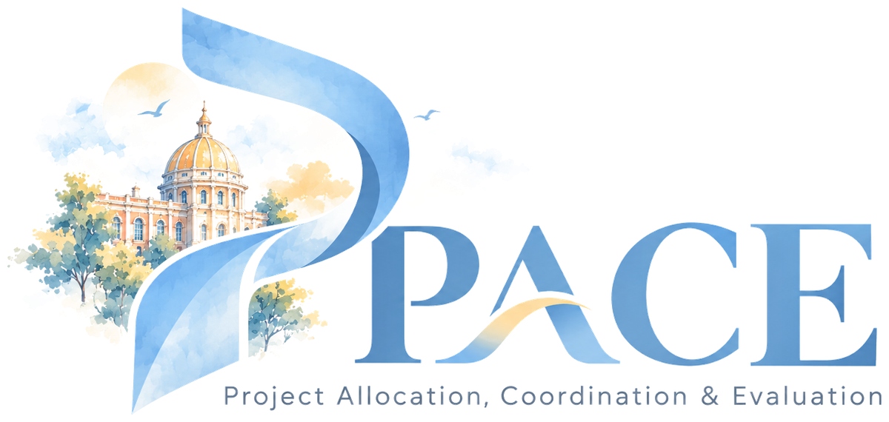

<p align="center"></p>

# PACE

**Project Allocation, Coordination & Evaluation**: the Project-Based Learning portal for Manipal University Jaipur. Students form
groups, choose a supervisor and report weekly. Supervisors approve groups,
grade the work and review achievements. The PBL office oversees every group and
posts student achievements to LinkedIn.

- **Stack:** Next.js 16 (App Router) · React 19 · Tailwind CSS v4 · Supabase (Postgres, Auth, Storage)
- **Three portals:** Student · Teacher (faculty / supervisor) · Administrator (PBL office)
- **Full walkthrough:** [`docs/PORTAL-GUIDE.md`](docs/PORTAL-GUIDE.md)

---

## Getting started

```bash
npm install
npm run dev
```

Open http://localhost:3000. `.env.local` needs:

| Variable | What it is |
| --- | --- |
| `NEXT_PUBLIC_SUPABASE_URL` | Supabase project URL |
| `NEXT_PUBLIC_SUPABASE_ANON_KEY` | Supabase anon (publishable) key |
| `LINKEDIN_CLIENT_ID` | LinkedIn app client ID (for posting achievements) |
| `LINKEDIN_CLIENT_SECRET` | LinkedIn app client secret (server only) |
| `LINKEDIN_REDIRECT_URI` | Optional. Defaults to `<site>/linkedin/callback` |
| `LINKEDIN_API_VERSION` | Optional `YYYYMM`. Defaults to two months back |
| `LINKEDIN_TOKEN_KEY` | Optional key that encrypts the stored token. Defaults to one derived from the client secret |

### Accounts

Test logins (supabase/migrations/20261028000002_test_accounts.sql). Each sign-in tab also has a one-click test button, and the email box fills in the domain, so you type only the part before the @.

| Portal | Email | Password |
| --- | --- | --- |
| Student (team lead of Team Test) | `teststudent1@muj.manipal.edu` | `pace@2026` |
| Student | `teststudent2@muj.manipal.edu` | `pace@2026` |
| Student | `teststudent3@muj.manipal.edu` | `pace@2026` |
| Team supervisor (mentor of Team Test) | `testteacher1@jaipur.manipal.edu` | `pace@2026` |
| Administrator | `testadministrator1@jaipur.manipal.edu` | `pace@2026` |

Everyone else signs up at `/signup` with their university email and confirms it
from the emailed link:

| Address | Becomes |
| --- | --- |
| `name.regno@muj.manipal.edu` | Student |
| `@jaipur.manipal.edu` in `app_private.admin_emails` | Administrator |
| any other `@jaipur.manipal.edu` | Team supervisor, linked to their row in the MUJ faculty directory (821 scraped) |

---

## What the portal does

| Portal | Pages |
| --- | --- |
| **Student** `/student/...` | Dashboard · My Group & Mentor (team, supervisor, signed PBL form) · Requests (invitations) · Weekly Reports · Grades & Feedback · Achievements · Queries · Notifications · Faculty Directory · My Profile · Settings |
| **Teacher** `/faculty/...` | My Groups · Mentor Requests (review the signed form: approve, ask for changes, reject) · Queries · Achievements (review, bonus marks, **approve and post to LinkedIn**) · Announcements |
| **PBL office** `/admin/...` | Overview of every group and unassigned student · move groups between supervisors · Announcements · Excellence & LinkedIn (portal LinkedIn account, award shortlist, posting) |

Documents (PDFs, images) open in an in-portal viewer built on PDF.js.

### Posting achievements to LinkedIn

Every post goes out from **one central LinkedIn account** for the whole portal.
Teachers never see its login.

1. When a supervisor clicks Approve on an achievement, a preview opens inside the
   teacher portal. It shows the post the way LinkedIn draws it in the feed, under the
   central account's name, written from the achievement's template, with an optional proof image.
2. The supervisor can adjust the text and clicks **Approve and post to LinkedIn**.
   The achievement is approved and published in one step. (*Approve without posting* is also there.)
3. The student is notified, and the achievement shows a link to the live post.

The **PBL office** connects the central account once from Excellence & LinkedIn.
They click **Connect LinkedIn** and sign in on LinkedIn's own page with the central
account, so its password never passes through the portal. The connection lasts
about 60 days; the page shows the days left and a **Reconnect** button. The access token is stored
encrypted (AES-256-GCM) with a key that exists only on the server. Setup:

1. Create an app at https://www.linkedin.com/developers/apps (it must be linked to a LinkedIn Page).
2. Under **Products**, add *Sign In with LinkedIn using OpenID Connect* and *Share on LinkedIn*.
3. Under **Auth → Authorized redirect URLs**, add `http://localhost:3000/linkedin/callback`
   and `https://<your-domain>/linkedin/callback`.
4. Put the client ID and secret in `.env.local` (and in the Vercel project's environment variables).

The central account is a LinkedIn *member* profile (for example, a dedicated
"MUJ PBL" profile). Posting as an official LinkedIn *Page* needs LinkedIn's
Community Management API, which LinkedIn has to approve separately.

---

## Architecture

```
src/
  app/
    student/ faculty/ admin/   One route group per portal; each layout wraps <PortalShell role=...>
    api/linkedin/              Route handlers: connect, callback, post (hold the LinkedIn secret)
    linkedin/callback/         Where LinkedIn returns after "Connect LinkedIn"
    login/ signup/             Authentication
  components/                  UI per feature (achievements/, shared/, staff/, ui/ ...)
  lib/
    data/repository.ts         The only place the browser talks to Supabase
    linkedin/server.ts         LinkedIn OAuth and posting (server only)
    achievements.ts            Achievement categories, question templates and post templates
    types.ts                   Domain model
supabase/migrations/           Schema, row-level security and database functions, in order
scripts/                       MUJ faculty scraper and importer
```

Row-level security does the authorisation. Every query runs as the signed-in
user, and state changes go through `security definer` database functions
(`review_achievement`, `record_linkedin_post`, ...). The LinkedIn route
handlers forward the user's Supabase token, so they need no service-role key.
The central LinkedIn token sits in `app_private.linkedin_account`, encrypted;
only the server can decrypt it.

---

## Design

The PACE logo and its square emblem live in `public/brand/` (transparent WebP
and PNG). The `Brand` component (`src/components/layout/brand.tsx`) draws the logo,
and `src/app/icon.png` is the browser-tab icon. The palette is sampled from `public/coverpage.webp`: ivory and warm sand
surfaces, muted gold from the dome as the accent, soft stone for text. All tokens
live in the `@theme` block at the top of `src/app/globals.css`. Type is Inter for
the interface and Fraunces for display headings.

---

## Still to do

- Teacher accounts: the 821 faculty in the directory must sign up before they can review.
- University single sign-on and "Forgot password" still show a *later release* message.
- Posting as an official LinkedIn Page instead of a member profile (needs LinkedIn's Community Management API approval).
- Analytics: project health score, at-risk detection, progress prediction.
